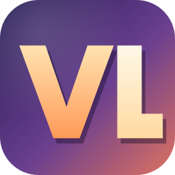
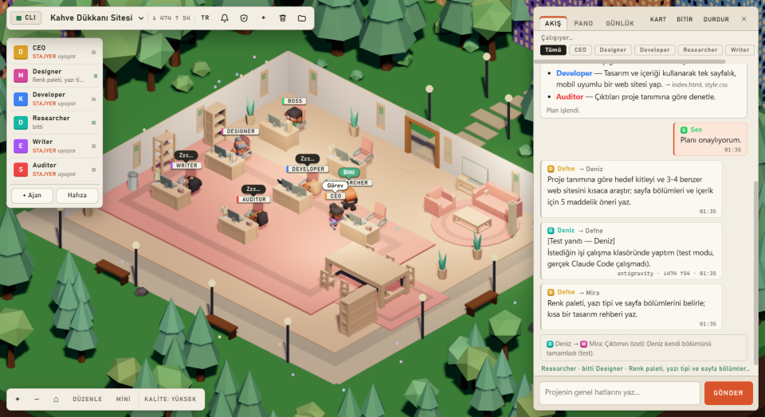
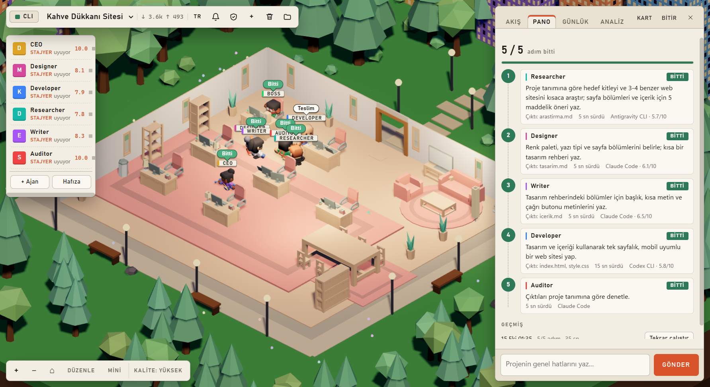
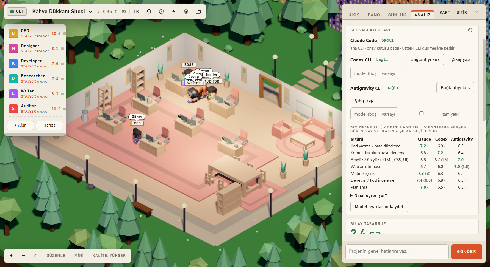
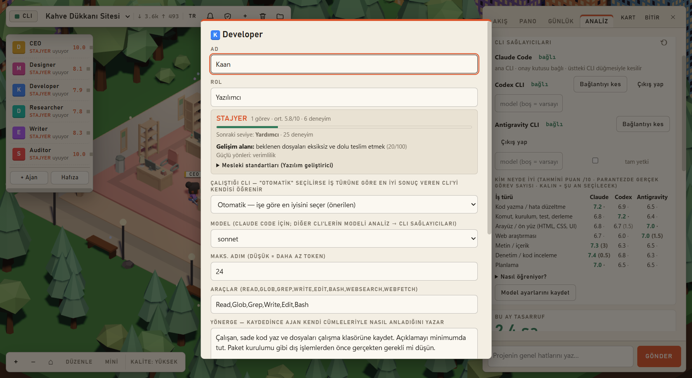
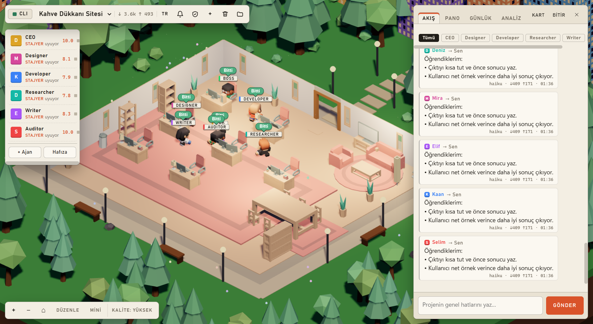
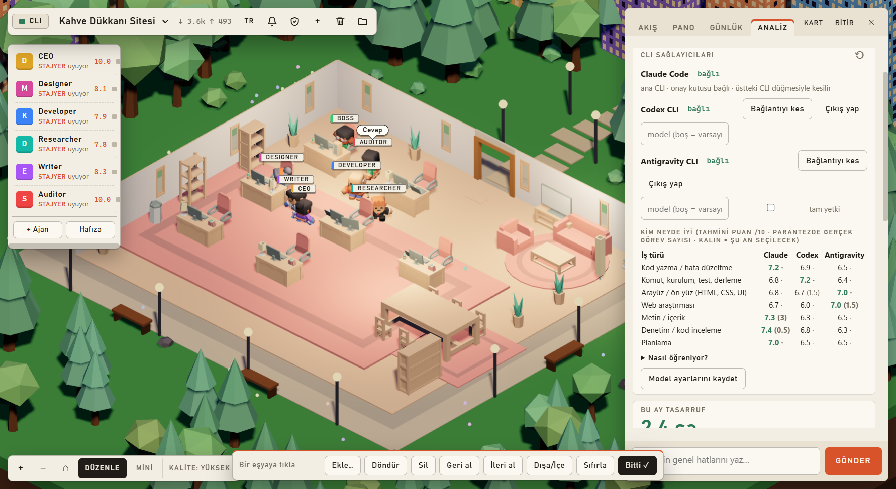

<div align="center">



# LIVAND Ofis

**Yapay zekâ ajanlarından oluşan bir ekibi 3B sanal ofiste yönet.**<br>
Sen projeyi anlatırsın → ekip lideri plan çıkarır → sen onaylarsın → ekip senin klasöründe çalışır.




</div>

## Neden LIVAND?
- **API anahtarı yok, sadece CLI:** Ajanlar bilgisayarındaki **Claude Code**, **Codex** ve **Antigravity** komut satırı araçlarıyla, kendi aboneliğinle çalışır. Hesap bilgilerin uygulamadan geçmez; ortamda bir API anahtarı olsa bile CLI'lere aktarılmaz.
- **3 ajan, esnek roller:** Ofisin ajanları CLI'lerin kendisidir: **Claude**, **Codex**, **Antigravity**. Tasarımcı, yazılımcı, araştırmacı, yazar, denetçi ayrı ajan değil, ajanın o işte taktığı **şapka**dır; ekip lideri her göreve işe en uygun ajanı atar ve zamanla "kim neyde iyi"yi öğrenir.
- **Birden çok ofis:** Her ofisin kendi lideri, üyeleri ve projeleri vardır; ofisler aynı anda çalışabilir. Bir ajan kendi içinde alt ajan açınca masasının yanında **stajyer** olarak belirir.
- **Gelişen ekip:** Her ajanın mesleki standartları, seviyesi, gelişim alanı ve kanıta dayalı dersleri var. Her görevden sonra ölçülebilir puan alır ve öğrendiklerini sonraki işlerde kullanır.
- **Güvenli çalışma:** Ajanlar yalnızca seçtiğin proje klasöründe serbesttir. Klasör dışı erişim, silme ve paket kurulumu gibi riskli işlemler onay kutusuna düşer; paket kurulumunda paket güvenliği gösterilir.
- **Görünür süreç:** Canlı görev panosu, adım adım günlük, token analizi ve tasarruf hesabı.

## Ekranlar
| Görev panosu | Günlük |
|---|---|
|  |  |
| **CLI sağlayıcıları ve "kim neyde iyi"** | **Ajan gelişimi** |
|  |  |
| **Sohbet ve plan** | **Ofis düzenleyici** |
|  |  |

> Görseller test modunda (gerçek CLI çalışmadan) örnek veriyle `npm run shots` ile üretilmiştir; sayılar örnektir.

## Hızlı başlangıç

### 1. Gereksinimler
- **Windows 10/11** (sunucu macOS/Linux'ta da çalışır; klasör seçme penceresi ve masaüstü kısayolu Windows içindir)
- **[Node.js](https://nodejs.org) 20 veya üstü**
- **Claude Code** (zorunlu; ana CLI ve onay kutusu buna bağlı)
- İsteğe bağlı: **Codex CLI** ve **Antigravity CLI**

### 2. Uygulamayı indir ve kur
```bash
git clone <bu deponun adresi> livand
cd livand
npm install
```

### 3. CLI'leri kur ve giriş yap
| CLI | Kurulum | Giriş |
|---|---|---|
| **Claude Code** (zorunlu) | `npm install -g @anthropic-ai/claude-code` | terminalde `claude` → `/login` (tarayıcıda onay) |
| **Codex** (isteğe bağlı) | `npm install -g @openai/codex` | uygulamada **Bağlan** (tarayıcıda onay) |
| **Antigravity** (isteğe bağlı) | PowerShell: `irm https://antigravity.google/cli/install.ps1 \| iex` | uygulamada **Bağlan** (Google girişi) |

> Antigravity **IDE** ile Antigravity **CLI** aynı şey değildir: ajanlar için `agy` komutu gerekir. IDE'de Google ile giriş yaptıysan CLI aynı girişi kullanır.

### 4. Çalıştır
```bash
npm run electron
```
Ya da `Ofis.cmd` dosyasına çift tıkla. Sadece sunucu için `npm start` → http://localhost:3000

### 5. Bağlan ve başla
1. Üstteki **CLI** düğmesi yeşilse Claude Code hazırdır.
2. **Analiz → CLI sağlayıcıları** kartında Codex ve Antigravity için **Bağlan**'a bas, onayı tarayıcıda ver.
3. **+** ile yeni proje aç, çalışılacak klasörü seç ve projeni anlat (veya hazır bir şablon seç).
4. Ekip liderinin planını onayla; ekip çalışmaya başlar.

## CLI bağlantısı
Üst çubuğun solundaki **CLI** düğmesi Claude Code bağlantısını gösterir: yeşil = bağlı, kırmızı "BAĞLI DEĞİL" = Claude Code yok veya giriş yapılmamış (tıklayınca yeniden denetler), gri **Bağlan** = bağlantıyı sen kestin.
- Bağlıyken tıkla → onay sorar → **Bağlantıyı kes**: çalışan tüm CLI süreçleri hemen sonlandırılır, bekleyen onaylar reddedilir, yarım görevler "iptal" olur; bağlantı kesikken hiçbir ajan çalışmaz. Tercih kaydedilir, uygulama yeniden açılınca da kesik kalır.
- **Bağlan**'a basınca giriş durumu yeniden denetlenir; yarım kalan proje "Devam et" ile kaldığı yerden sürer.

## Ofisler, ajanlar ve şapkalar
- **Ajan = CLI.** Ofiste en fazla 3 masa vardır: Claude, Codex ve Antigravity (yalnızca ofise üye olanlar). Ajana tıklayınca görünen adı, (Claude için) modeli, seviyesi ve son değerlendirmeleri görünür.
- **Şapka = görev rolü.** Ekip lideri, tasarımcı, yazılımcı, araştırmacı, yazar, denetçi (ve senin eklediklerin). Her şapkanın yönergesi, araçları, becerileri ve dersleri vardır; şapkayı hangi ajan takarsa o işte bunlar istemine girer. Roster'daki **Şapkalar** düğmesinden düzenlenir; bir şapkaya "tercih edilen ajan" verebilirsin.
- **Ekip lideri:** Her ofisin lideri (varsayılan Claude) planı çıkarır ve her göreve bir ajan atar ("kim neyde iyi" tablosunu ipucu olarak görür). Atanmayan görevi ofis, şapka tercihine ya da tabloya göre bir üyeye verir. Lider masası ön sıradadır, etiketinde **LİDER** yazar; çalışan ajanın etiketinde o an taktığı şapka görünür.
- **Ofisler:** Üst çubuktaki ofis seçiciden ofis değiştirilir; ⚙ ile ad, lider ve üyeler düzenlenir, **+ Yeni ofis** ile yenisi açılır. Projeler bir ofise bağlıdır; bir ofis silinirse projeleri silinmez, ilk ofise taşınır. Ofisler aynı anda çalışabilir; her CLI'nin eşzamanlı iş sınırı Analiz'deki **paralel** ayarıdır (CLI başına, varsayılan 2), fazlası sıraya girer.
- **Stajyerler:** Bir ajan kendi içinde alt ajan açtığında (Claude Code'un Agent/Task aracı) masasının yanında küçük bir **stajyer** belirir, roster'da "1 stajyer" yazar, iş bitince kaybolur.
- **Ortak klasör:** Üç ajan da projenin aynı çalışma klasöründe çalışır; gözden geçirirken dosyaları kendileri açıp okur (isteme gömülmüş özet değil).
- **Eski sürümden geçiş:** İlk açılışta eski rol ajanları (CEO, tasarımcı…) dersleri, becerileri ve yönergeleriyle şapkaya dönüşür; mevcut projeler "Ana ofis"e bağlanır; "kim neyde iyi" tablosu korunur.

## Çoklu CLI: Claude Code, Codex, Antigravity
Ajanlar Claude Code'un yanında **OpenAI Codex CLI** (`codex exec --json`) ve **Google Antigravity CLI** (`agy -p --output-format stream-json`) ile de çalışabilir.
- **Bağlan:** **Analiz → CLI sağlayıcıları** kartında **Bağlan**'a bas. Codex tarayıcıda OpenAI giriş sayfasını açar. Antigravity önce Antigravity IDE'deki Google girişini sessizce dener (`agy models`, token harcamaz); giriş yoksa ayrı bir pencere açar ve tarayıcıda Google girişi istenir. Onayı web'de sen verirsin; parola ya da anahtar bu uygulamadan geçmez. Tarayıcı açılmazsa kartta **Onay sayfasını aç** düğmesi çıkar.
- **Bağlantıyı kes:** O CLI'ye yeni iş verilmez ve çalışan süreçleri hemen durur; yarım kalan görev Claude Code ile sürer. **Çıkış yap**, CLI'nin bu bilgisayardaki girişini de siler.
- Model alanı boşsa CLI'nin kendi varsayılan modeli kullanılır.
- **Görev ataması:** Ekip lideri her göreve bir ajan atar; atanmamışsa şapkanın sabit tercihi, o da yoksa "kim neyde iyi" tablosu (yalnızca ofis üyeleri arasından) seçer.
- **Kim neyde iyi?** Görevin iş türünde en yüksek tahmine sahip ajan seçilir; az denenmiş bir ajana ara sıra (%10) şans verilir.
- **Tahmin nereden gelir?** Başlangıçta kamuya açık kıyaslardan gelen hafif bir ön bilgi (Claude: gerçek depo hatası düzeltme/SWE-bench; Codex: terminal görevleri/Terminal-Bench; Antigravity/Gemini: web arayüzü ve Google aramalı araştırma); bu bilgi sadece 3 görev ağırlığındadır. Sonra projelerindeki ölçülebilir puanlar (teslimat, denetçi kalitesi, verimlilik) ve Bitir'de verdiğin puan (yarım ağırlık) eklendikçe tablo senin kullanımına göre değişir. Tablo kartta görünür; ⟲ ile sıfırlanır.
- **Hata olursa:** Codex/Antigravity bir görevde hata verirse bu 1 puan sayılır ve görev Claude Code ile bir kez daha denenir.
- **Güvenlik farkı:** Codex ve Antigravity ofisin onay kutusuna bağlanamaz (Claude Code'daki `--permission-prompt-tool` karşılığı yok). Bu yüzden kendi sandbox'larında, çalışma klasörüyle sınırlı ve onay sormadan çalışırlar: Codex `--sandbox workspace-write` (ağ kapalı, bu yüzden web araştırmasına atanmaz), planlamada `read-only`; Antigravity `--sandbox --mode accept-edits` (dosya düzenleyebilir; komut çalıştırma sadece "tam yetki" açıksa). Paket kurma veya klasör dışı erişim gerektiren riskli işlerde ajanı Claude Code'da tut.
- **Sonradan denetim:** Codex ve Antigravity önceden soramadığı için her görevden sonra kayıt noktaları arasındaki fark kodla denetlenir (token harcamaz): eklenen/değişen betik ve çalıştırılabilir dosyalar (`.ps1`, `.bat`, `.sh`, `.exe`…), gizli bilgi dosyaları (`.env`, anahtar, `.npmrc`…), CI/kanca/ajan ayarları, toplu silme, `package.json`'a eklenen bağımlılıklar ve kurulumda kendiliğinden çalışan betikler (`postinstall`…). Riskli bir şey varsa sohbette uyarı ve bildirim çıkar; panodaki "↶ Bu adımdan önceye dön" ile tek tıkla geri alınır.
- **Codex web araması (isteğe bağlı):** Analiz → CLI sağlayıcıları → Codex → **web araması** açılırsa Codex'in yerleşik arama aracı açılır (`-c web_search="live"`); kabuk komutlarında ağ yine kapalıdır. Açıkken web araştırması görevleri Codex'e de verilebilir, böylece bu işler hep Claude'a kalmaz.
- **Codex Windows'ta:** Codex'e her çalıştırmada `windows.sandbox="unelevated"` verilir (yönetici kurulumu gerektirmez). Bu olmadan Windows'ta salt okunur ve çalışma modunda tüm kabuk komutları "blocked by policy" ile reddediliyor, Codex dosya okuyamıyordu. Sınırlar korunur: gözden geçirmede (`read-only`) dosya yazamaz, işte (`workspace-write`) yalnızca proje klasörüne yazar. Ekran görüntüsü aracına yalnızca o araç için onay verilir (`tools.screenshot.approval_mode="approve"`).
- **Antigravity gözden geçirmede:** Plan modunda çalışır ve dosya yazamaz (agy 1.3.5'te `--disable-slash-commands` ile birlikte `--mode plan` etkisiz kaldığı için bu bayrak yalnızca iş aşamasında verilir).
- **Antigravity ekran görüntüsü aracı:** agy'de çalıştırma başına MCP bayrağı yoktur. Ofis, Antigravity çalışırken proje klasörüne geçici bir `.agents/mcp_config.json` yazar; senin aynı adlı dosyan varsa korunur ve iş bitince aynen geri yazılır, yoksa silinir. Başsız modda MCP izni sorulamadığı için **Analiz → CLI sağlayıcıları → Antigravity → Ekran görüntüsü ve ekip araçları: Bağla** düğmesi, onayınla genel ayar dosyasına (`~/.gemini/antigravity-cli/settings.json`) yalnızca ofisin kendi araçları için dar kurallar ekler: `mcp(ofis/screenshot)` ile `team_message`, `team_inbox`, `team_ask`, `team_request` ve `memory_search` için birer `mcp(ofis/…)` kuralı. Başka hiçbir izin açılmaz, **Kaldır** ile hepsi geri alınır. Eski sürümde yalnızca ekran görüntüsü kuralını eklediysen düğme yeniden "Bağla" görünür; ekip araçları için bir kez daha onay ver. Bağlı değilse Antigravity verilen ekran görüntüsü yollarını açar.
- **İnceleyemeyen gözden geçiren:** Bir ajan dosyaları okuyamaz ya da yanıt biçimine uymazsa boş bulgu listesi "sorun yok" sayılmaz; inceleme Claude Code ile bir kez daha yapılır.
- Kısa metin çağrıları (soru-cevap, ders çıkarma) her zaman Claude Code ile yapılır.

## Claude limiti
**Analiz** sekmesinin en üstünde oturum (5 saatlik) ve haftalık kullanım yüzdesi, çubuk ve yenilenme zamanı görünür. Değerler Claude Code'un kendi `/usage` komutundan (`claude -p /usage`) okunur; bu komut model çağırmaz, **token harcamaz**. Açılışta, her çalıştırma bitince ve 10 dakikada bir kendiliğinden tazelenir; ↻ ile elle yenilenir. Üstteki CLI düğmesi oturum yüzdesini gösterir (örn. "CLI %48"); limit dolarsa "Limit doldu" olur. Kimlik bilgisi dosyalarına erişilmez.

## Akış
1. Ofisi seç → yeni proje → klasör seç (veya varsayılan) → projeyi anlat ya da hazır şablon seç.
2. Ekip lideri kısa araştırma yapıp görev planı çıkarır; her göreve bir ajan ve bir şapka atar; planı onaylarsın (veya değişiklik istersin).
3. Ajanlar görevleri sırayla/paralel yapar; riskli her işlem onay kutusuna düşer.
4. Bitirince puan verirsin; ajanlar dersler çıkarır ve sonraki projelerde kullanır.

## Panel sekmeleri
- **Akış**: sohbet, plan kartı, onay kartları.
- **Pano**: canlı görev panosu (Bekliyor / Çalışıyor / Bitti / Sorunlu); her görevde süre, çalıştıran CLI ve puan; altta **geçmiş çalıştırmalar** ve "Tekrar çalıştır".
- **Günlük**: ajanların yaptığı her adım (araç, sonuç, hata, alt ajan, CLI seçimi, görev başladı/bitti) canlı akar.
- **Analiz**: Claude limiti, CLI sağlayıcıları ve "kim neyde iyi" tablosu, tasarruf, toplam/proje/ajan bazında token, son 13 haftanın ısı haritası, proje başına token bütçesi.

## Ajanların gelişimi
Gelişim iki katmanlıdır: **ajanın** (CLI) seviyesi ve puanları, **şapkanın** mesleki standartları, gelişim alanı ve dersleri. Her şapkanın **mesleki standartları** ve **teslim öncesi kontrol listesi** vardır; o şapkayla yapılan her görevde istemine standartları, **gelişim alanı** (son görevlerdeki en zayıf ölçütü) ve en güçlü 6 dersi eklenir. Böylece bir ders (ör. yazarlıkta öğrenilen) şapkayı hangi ajan takarsa onunla gelir.
- **Dersler kendiliğinden oluşur:** Görevden sonra ölçülebilir puandan (eksik dosya, çok adım, reddedilen işlem, gereksiz soru) ve denetçinin notundan token harcamadan ders çıkar; ajan da her işin sonunda tek cümlelik **öz değerlendirme** yazar. Projeyi bitirince senin puanından çıkan dersler en yüksek ağırlığı alır.
- Benzer dersler birleşip güçlenir, eskiler zamanla zayıflar (30 günde yarılanır); en fazla 24 ders tutulur.
- **Seviye (ajanın):** Çırak → Yardımcı → Uzman → Kıdemli → Usta. Deneyim her görevin puanı kadar artar; ortalama kalite düşükse seviye sınırlanır. Seviye atlayınca ajan sohbette haber verir.
- Ajana tıklayınca seviyesi ve son değerlendirmeleri; **Şapkalar**'dan bir şapkaya tıklayınca gelişim alanı, standartlar ve dersler (kaynağıyla) görünür; istemediğin dersi silebilirsin.

## Ajan becerileri
Her şapkanın gerçek meslek yöntemlerinden oluşan becerileri vardır; her beceri **adımlar** ve **"bitti sayılması için" ölçütlerinden** oluşur (`lib/skills.mjs`).
- **Tasarımcı:** tasarım sistemi, erişilebilir tasarım (WCAG AA), duyarlı yerleşim, kullanıcı akışı, marka kimliği.
- **Yazılımcı:** semantik HTML, duyarlı CSS, erişilebilir kod, form doğrulama, temiz JavaScript, çalıştır ve doğrula, performans ve teknik SEO.
- **Araştırmacı:** kaynak doğrulama, rakip analizi, hedef kitle, yerel işletme görünürlüğü.
- **Yazar:** dönüşüm odaklı metin, SEO uyumlu metin, marka sesi, arayüz metinleri, blog yazısı.
- **Denetçi:** teslim kontrolü, web sitesi denetimi, erişilebilirlik denetimi, kod incelemesi, içerik denetimi.
- **Ekip lideri:** kapsam netleştirme, paralel planlama.

Her görevde görev metnine en uyan **en fazla 3 beceri** istem içine girer (az token); üç CLI de aynı şekilde kullanır. Panoda her adımda hangi becerilerin uygulandığı görünür. Şapka kartındaki **Becerileri** bölümünden beceri açıp kapatabilir, adımlarını görebilir ve **kendi becerini** ekleyebilirsin (ad, tetikleyen kelimeler, adımlar; kelime boşsa her görevde uygulanır). Senin eklediğin beceri, uyduğunda hazır becerilerin önüne geçer. **Kendi şapkan** (Şapkalar → + Kendi şapkan) becerilerini seçtiğin yetenek şablonundan alır.

## Ürün modu: tek yapımcı ↔ gözden geçirenler
Araştırmalar (Cognition, [Multi-Agents: What's Actually Working](https://cognition.com/blog/multi-agents-working), 2026; [Don't Build Multi-Agents](https://cognition.com/blog/dont-build-multi-agents); Anthropic, [multi-agent research system](https://www.anthropic.com/engineering/multi-agent-research-system); MetaGPT) aynı sonuca varıyor: aynı ürüne **paralel yazan** ajanlar birbirinin örtük kararlarını göremez ve tutarsız sonuç üretir (ör. kuş ve arka plan farklı tarzda); işe yarayan, **yazmanın tek elden** yapılması ve diğer ajanların girdi, gözden geçirme ve öneriyle zekâ katmasıdır. Ofis site/uygulama/oyun gibi ürünlerde bu modelle çalışır:
1. **Girdiler (paralel):** Araştırmacı, yazar ve tasarımcı şapkalı ajanlar yapımcıya belge hazırlar (bulgular, sayfa metinleri, tasarım yönü). Ekip lideri vizyona **tarz** (yaratıcı yön) ve **yapı** (sayfa/ekran bölümleri) yazar.
2. **Tek yapımcı:** Yazılımcı şapkasını takan tek ajan ürünü **tasarım dahil** baştan sona yazar. Girdileri özet değil **tam metin** olarak alır, tasarım becerileri de ona verilir, daha çok adım hakkı vardır. Örtük kararlarını (palet, yazı tipi, yerleşim, dosya yapısı) "---KARARLAR---" altında açıkça yazar; kararlar sohbete ve gözden geçirenlere gider. **Görerek çalışır:** ofisin MCP sunucusundaki `screenshot` aracıyla (onay sormaz) ilk taslaktan ve her büyük görsel değişiklikten sonra sayfasının tam sayfa ekran görüntüsüne bakıp düzeltir (yaz → bak → düzelt). Araç üç ajanda da vardır: Claude Code'a ofisin MCP ayarıyla, Codex'e her çalıştırmada `-c mcp_servers…` ile (`~/.codex` ayarın değişmez), Antigravity'ye proje klasöründeki geçici `.agents/mcp_config.json` ile verilir (aşağıya bak).
3. **Gözden geçirme (temiz bağlam, yazmaz):** Denetim (kabul ölçütleri, hatalar, kod sağlamlığı) ve tasarım incelemesi (ekran görüntüleri) **yapımcıdan farklı ajanlara** verilir: farklı model kendi işini övmez. Örneğin Claude yazarsa Codex denetler, Antigravity tasarıma bakar; ofiste tek ajan varsa aynı ajan temiz bağlamla bakar. Kesin kontrol hataları ve tarayıcı sorunları da bulguya eklenir.
4. **Triyaj (tartışma):** Yapımcı her bulguya kullanıcının isteği ve vizyona göre "uygulandı" ya da "reddedildi — gerekçe" der ve kabul ettiklerini kendisi uygular (sohbette görünür). Sonraki turda gözden geçirenler reddedilenleri gerekçesiyle görür, ikna olmazlarsa tekrar eder. Ciddi bulgu kalmayınca biter; Analiz → Ekip içi inceleme ile tur sayısı (varsayılan 2) değişir.
Ürün işi olmayan projeler (araştırma, blog, içerik) ekip toplantısı akışıyla yürür. Yapımcının düzeltmeleri ilk yapımla aynı CLI'de çalışır.

**Codex ve Antigravity nasıl çalışır:** İstemler Claude Code'a göre yazıldığından, bu iki CLI'ye ayrıca bir **çalışma ortamı notu** eklenir: Claude araç adlarının (Read, Grep, WebSearch…) yerine kendi araçlarını kullanmaları, neyi yapıp yapamayacakları (Codex: ağ kapalı; Antigravity: "tam yetki" kapalıyken komut çalıştıramaz; gözden geçirmede ikisi de salt okunur) ve yanıt biçimine harfiyen uymaları. Ayrıca bir CLI işin olmazsa olmazını karşılayamıyorsa o işe verilmez: web araştırması Codex'e, asset aracı/çalıştırıp doğrulama gerektiren iş "tam yetki" kapalı Antigravity'ye gitmez; ajan o CLI'ye sabitlenmiş olsa bile görev Claude Code ile çalışır ve nedeni günlüğe yazılır.

> İpucu: Ürünün kalitesinin tavanı yapımcının modelidir. Yazılımcıyı (ajan kartından) en güçlü modele almak en büyük farkı yaratır.

## Özgün tasarım: jenerik "yapay zekâ sitesi" görünümüne karşı
Yönlendirilmeyen model, eğitim verisindeki en yaygın ve en "güvenli" tasarıma yakınsar: Inter fontu, mor gradyan, birbirinin aynısı kartlar ([Anthropic, Improving frontend design through skills](https://claude.com/blog/improving-frontend-design-through-skills)). Ofis buna dört katmanla karşı koyar ([anthropics/skills frontend-design](https://github.com/anthropics/skills), [impeccable](https://github.com/pbakaus/impeccable), [ui-ux-pro-max](https://github.com/nextlevelbuilder/ui-ux-pro-max-skill) ve [SuperDesign](https://github.com/superdesigndev/superdesign) yaklaşımlarından):
1. **Estetik kurallar ve yasaklar listesi** (`lib/design.mjs`): Yapımcının istemine konunun kendi dünyasından türetilen görsel yön, işe özel font çifti, adlandırılmış palet, atmosfer ve tek bir hareket anı kuralları girer. Ayrıca açık bir **YAPMA** listesi eklenir: Inter/Roboto, mor/indigo gradyan, gradyanlı metin, aynı kart ızgarası, her bölüme fade-in, emoji ikonlar. Tasarımcı şapkasının **Ayırt edici estetik** becerisi her görevde öne alınır. Tasarım incelemesi de "bu ürün sıradan bir yapay zekâ sitesine benziyor mu?" sorusuna bakar.
2. **Sektöre göre hazır yönler:** Kafe, perakende, sağlık, finans, teknoloji, eğitim, güzellik, oyun, turizm ve kişisel site için 1-2 denenmiş yön (palet hex değerleriyle, font çifti, yerleşim fikri, kaçınılacaklar) bulunur. Ekip lideri brief'e uyan sektörün yönlerini planlarken görür ve vizyondaki **tarz** alanını bunlardan biriyle ya da daha iyisiyle somut yazar. Tarz alanı 1500 karaktere kadar korunur (eskiden 240'ta kesiliyordu). Tasarımcının `DESIGN.md` belgesi yapımcıya her zaman tam metin gider.
3. **Kodla jenerik tasarım denetimi (token harcamaz):** Otomatik doğrulama yalnızca yaygın fontlar, mor gradyan, gradyanlı metin, 6+ "card" öğesi, 5+ giriş animasyonu, 4+ emoji ve başlıkta tek kelime vurgusu kalıplarını yakalar. Bunlar panoda ◇ işaretiyle görünür; ürün modunda "orta" önemli bulgu olarak yapımcıya gider, yapımcı kabul eder ya da gerekçesiyle reddeder.
4. **Yön keşfi** (Analiz → Yön keşfi, varsayılan kapalı): Yapımcı başlamadan önce 3 farklı görsel yönde yalnızca ilk ekran üretilir (`.livand-yonler/`). Ekran görüntüleri alınır, ekip lideri en uygun ve en az jenerik olanı seçer. Yapımcı ürünü bu yönün üzerine kurar. Böylece kötü bir başlangıç yönü cilalanmak yerine en başta elenir. Bir ek çalıştırma kadar token harcar.

**Kullanılabilirlik denetimi (token harcamaz):** Sözdizimi doğru olsa da ziyaretçinin "düğmeler çalışmıyor" diyeceği durumları kodla yakalar:
- hiçbir yere gitmeyen bağlantılar (`href="#"`, boş; logo hariç) ve hiçbir betiğe bağlanmamış düğmeler,
- haritayı açmayan "Yol tarifi" düğmeleri ve sayfadaki sokak adresini içermeyen harita bağlantıları,
- bağlantısız Instagram/telefon/e-posta, sahte numaraya giden arama/WhatsApp düğmeleri (`tel:+905XXXXXXXXX`),
- ziyaretçiye görünen "yer tutucu" notları ve uzun tek sayfada kaydırınca kaybolan menü.

Bulgular panoda ⚑ ile görünür; ürün modunda "orta" önemli bulgu olarak yapımcıya, ekip modunda toplantı gündemine gider. Yapımcının istemine aynı kurallar baştan eklenir; denetçi her düğmenin tıklanınca gerçek işini yapıp yapmadığına bakar.

## Proje yönetimi: kabul ölçütleri → sözleşme → uygulama → doğrulama
Ekip, MetaGPT/ChatDev'deki gibi aşamalı ve belgeye dayalı çalışır; iş, ölçülebilir ölçütler karşılanana kadar bitmiş sayılmaz.
1. **Kabul ölçütleri:** Ekip lideri planla birlikte 3-8 gözlemlenebilir ölçüt yazar (K1, K2…) ve her görevi karşılaması gereken ölçütlere bağlar. Ajan kendi ölçütlerini istemde görür ve teslimden önce kontrol eder.
2. **Sözleşme:** Birden çok kişinin aynı ürüne katkı verdiği işlerde ilk görev ortak bir sözleşme belgesidir (dosya yapısı, adlar, tokenlar, veri biçimleri); diğerleri ona göre paralel çalışır.
3. **Otomatik doğrulama (token harcamaz):** Kırık sayfa içi bağlantı, bulunamayan dosya (görsel, betik, stil, atlas), JS/JSON sözdizimi, yer tutucu metin, eksik viewport/başlık/alt metni kodla bulunur. Giriş sayfası varsa gizli bir Electron penceresinde açılır; ağın boşalması, web fontları ve görseller beklendikten sonra **masaüstü ve mobil tam sayfa ekran görüntüsü** alınır (sayfa ekran yüksekliğinde dilimlerle kaydırılarak çekilir, görünüm başına en fazla 6 dilim; kaydırınca beliren bölümler de tetiklenir), konsol hataları ve yatay taşma yakalanır. Ardından **tıklama testi** görünür her düğme ve bağlantıya (görünüm başına en fazla 20) gerçekten tıklar: tıklanınca hiçbir şey olmayan, başka bir öğenin altında kalıp tıklanamayan ve hedefi sayfada olmayan öğeler tarayıcı hatası olarak bildirilir (dış bağlantılar açılmaz, yalnızca hedefi kaydedilir). Dış ağda yalnızca font/CDN/görsel sunucularından (Google Fonts, cdnjs, jsDelivr, unpkg, Unsplash…) GET isteğine izin verilir; diğerleri engellenir ve hata değil uyarı olarak raporlanır. Doğrulama denetimden önce, ekip toplantısından önce ve en sonda çalışır.
4. **Denetim:** Denetçi kesin kontrol sonuçlarını ve ekran görüntülerini görür, her kabul ölçütünü "geçti/kaldı" diye kanıtıyla işaretler. Kalan ölçütler ve kesin kontrol hataları ekip toplantısının gündemine, ilgili dosyanın sorumlusuna atanarak girer.
5. **Son rapor:** "Kabul ölçütleri: 5/6 karşılandı", otomatik doğrulama sonucu ve dosyalar. Panoda ölçütlerin durumu, doğrulama ayrıntıları ve ekran görüntüleri görünür.

**Canlı önizleme:** Üst çubuktaki göz düğmesi ekibin ürettiği siteyi/oyunu büyük bir pencerede açar (masaüstü/mobil, yenile, tarayıcıda aç); bir adım bitince kendiliğinden yenilenir. Önizleme **ayrı bir porttan** (ana port + 1, `OFIS_PREVIEW_PORT` ile değişir), yalnızca projenin klasöründen ve salt okunur sunulur; uygulamanın API'si yalnızca kendi portundan gelen tarayıcı isteklerini kabul ettiği için üretilen sayfa API'ye erişemez.

**Geri alma (git kayıt noktaları):** Her adım başlamadan önce ve bittikten sonra çalışma klasörünün hâli, uygulamanın veri klasöründeki **ayrı bir gölge git deposuna** kaydedilir (`data/snaps/<proje>/repo.git`). Yalnızca değişen dosyalar saklandığı için **boyut sınırı yoktur**; görselli oyun projeleri de geri alınabilir. Kullanıcının kendi `.git`'ine, dallarına ve git ayarlarına dokunulmaz; `node_modules` kaydedilmez. Panoda "↶ Bu adımdan önceye dön" klasörü o hâline döndürür: değişen ve silinen dosyalar geri gelir, sonradan oluşan dosyalar **silinmez**, yedek klasörüne taşınır; geri almadan önce de bir kayıt noktası alınır (geri alma da geri alınabilir). Git kurulu değilse eski yönteme (50 MB'a kadar kopya) düşülür. Geri alınan adımlar sıraya döner, "Devam et" ile yeniden çalışır.

**Değişiklik raporu ve dosya çakışması:** Panoda her adımın altında o adım sürerken klasörde ne değiştiği görünür (yeni/değişen/silinen dosyalar). Aynı dosyaya paralel çalışan iki görev yazarsa bu anında yakalanır: günlüğe düşer, panoda "Dosya çakışması" yazar ve iki ajanın gelen kutusuna "dosyayı yeniden oku, gerekiyorsa anlaş" mesajı gider.

**Düzeltmelerde bağlam:** Düzeltme ve akran önerisi turlarında ajan kendi önceki raporunu görür; dosyaları baştan keşfetmez (token tasarrufu). Claude Code oturumlarını sürdürmek (resume) bilinçli olarak kullanılmaz: oturum kayıtlarını kullanıcının ev klasörüne yazar.

## Yetenekler ve proje türleri
Ekip lideri planlarken ofisin **yetenek kataloğunu** görür ve görevlere yetenek atar (plan kartında ve panoda rozet olarak görünür). Atanan yeteneğin kullanım talimatı o görevin istemine girer; gerekiyorsa göreve ek araç (ör. Bash) açılır. ekip lideri hiç yetenek atamazsa (ya da şablon kullanılırsa) görev metnine göre otomatik tamamlanır.
- **Görsel/asset hattı** (tasarımcı, yazılımcı): `tools/assets.mjs` — bağımlılıksız PNG aracı. `pixel` (piksel sanatı JSON → PNG, animasyon kareleri → şerit), `nobg` (arka planı saydam yap; kenardan dolgu, karakterin içi korunur), `trim`, `split --auto|--grid` (sprite sheet'i assetlere böl + manifest), `pack` (atlas.png + atlas.json), `scale`, `info`. Bu araç çalışma klasörü içinde ve zincirleme komut olmadan **onay beklemeden** çalışır.
- **Vektör çizim (SVG)**: logo, ikon, karakter, katmanlı arka plan.
- **Çalıştırıp doğrulama** (yazılımcı): sözdizimi ve test komutları.

- **Görsel üretimi (Codex, isteğe bağlı)**: Codex CLI'nin yerleşik görsel üretimiyle (gpt-image-2) gerçek görsel üretir: karakter, sprite, arka plan, illüstrasyon. **Ayrı ücret yoktur**: görseller ChatGPT aboneliğinin Codex limitinden düşer. Açmak için **Analiz → CLI sağlayıcıları → Codex → görsel üretimi**.
  - **Ücretsiz kalma garantisi:** Yalnızca Codex **ChatGPT aboneliğiyle** giriş yaptıysa açılabilir (`codex login status` → "Logged in using ChatGPT"); API anahtarıyla girişte görseller ücretli API'den faturalanacağı için seçenek kapalı kalır. `OPENAI_API_KEY`/`CODEX_API_KEY` CLI'lere hiçbir zaman geçirilmez ve ajana ücretli "CLI fallback" yolunu kullanmaması söylenir.
  - **Limit koruması:** Görsel turları limiti metne göre 3-5 kat hızlı tüketir. Bu yüzden proje başına bir sınır vardır (varsayılan 8, en fazla 30). Görsel üretimi yalnızca lider "gorsel-uret" yeteneği verdiği görevde ve o görev Codex'te çalışırken açılır; diğer bütün Codex çalıştırmalarında `features.image_generation=false` verilir, yani Codex kendi kararıyla görsel üretip limiti harcayamaz. Hak biterse ya da görev Codex dışında çalışırsa ajan piksel sanat/SVG'ye döner.
  - **Dosyalar:** Codex görselleri kendi klasörüne (`~/.codex/generated_images/`) yazar. Ajan bunları proje klasörüne kopyalar; kopyalamadığı yeni görselleri ofis iş bitince `assets/uretilen/` altına alır (Codex'teki asıllarına dokunulmaz). Görsel üreten Codex çalıştırmaları, hangi görselin hangi projeye ait olduğu karışmasın diye sırayla çalışır.
  - **Saydam arka plan:** Görsel düz renk (ör. #00ff00) arka planla istenir, sonra asset aracının `nobg` komutuyla temizlenir (Python gerekmez).
  - Antigravity CLI'de görsel üretimi yok; Claude Code görsel üretmez.

> Görsel üretimi kapalıyken görseller piksel sanat ya da SVG olarak üretilir. Senin verdiğin PNG'ler (ör. bir sprite sheet) çalışma klasörüne konursa arka planı kaldırılıp assetlere bölünebilir.

**Proje türü rehberleri:** İstek bir türe uyuyorsa (oyun, web sitesi, web uygulaması) ekip liderine önerilen iş akışı verilir. Örneğin oyunda: tasarım belgesi + asset listesi ve atlas sözleşmesi → assetler ile oyun kodu **paralel** → oynanabilirlik denetimi. Oyun için ayrıca beceriler var: oyun tasarım belgesi, oyun asseti üretimi, oyun geliştirme (Canvas), oyun denetimi.

## Ekip iletişimi: ajanlar çalışırken birbirine yazar
Ajanlar yalnızca lider ve toplantılar üzerinden değil, **çalışırken doğrudan** da konuşur. Ofisin MCP sunucusu (`approver.js`) üç CLI'ye de şu araçları verir (Claude'a ofisin MCP ayarıyla, Codex'e çalıştırma başına `-c` ile, Antigravity'ye Analiz'deki **Bağla** düğmesiyle eklenen dar kurallarla):
- **team_message** `{to, text}`: bir şapkaya ya da herkese not bırakır (ör. "karakterler 32×32 olacak"). Sohbette de görünür.
- **team_inbox**: gelen mesajları okur. Görev başlarken okunmamış mesajlar zaten isteme girer.
- **team_ask** `{to, question}`: işi engelleyen bir soruyu **hemen** sorar; diğer şapka kısa bir Claude çağrısıyla, projenin özetini ve kendi işini görerek yanıtlar. Görev başına en fazla 3.
- **team_request** `{to, work, deliverable}`: başka bir şapkaya ayrı bir iş verir (ör. yapımcı tasarımcıdan "kahramanın yürüme kareleri"ni ister). İş panoya "istek" olarak eklenir ve **paralel** çalışır; bitince isteyenin gelen kutusuna haber gider. Rapor ve puanlama, istekler bitmeden yapılmaz. Proje başına en fazla 3.
- **memory_search** `{query}`: uzun süreli bellekte arar (aşağıya bak).

## Uzun süreli bellek
Her şapka istemine en güçlü 6 dersini taşır ve en fazla 24 ders tutar. Bunun dışına düşen dersler artık **kaybolmaz**, uzun süreli belleğe (`data/memory.json`, en fazla 2000 kayıt) gider. Biten her projenin isteği ve sonucu, yapımcının kararları, seçilen tarz, senin puanın ve isteme sığmayan eski tercihlerin de buraya yazılır.
- **Arama API'siz:** Vektör veritabanı ve gömme modeli yerine BM25 anahtar kelime araması kullanılır; Türkçe ekler için kelimeler köke yakın kısaltılır ("oyunların" ~ "oyunlar"). Kayıtlar 6 ayda yarı ağırlığa iner.
- Her görevde işe en ilgili 4 kayıt "GEÇMİŞTEN HATIRLADIKLARIN" olarak isteme girer (zaten istemde olan dersler tekrar girmez); bir şapkanın dersleri yalnızca o şapkaya, proje/karar kayıtları herkese gelir. Ajan `memory_search` ile kendisi de arayabilir.
- `GET /api/longmem?q=...` ile aranır, `POST /api/longmem {"delete":"<id>"}` ile kayıt silinir.

## Ekip içi inceleme
- **Ortak ürün vizyonu:** Ekip lideri projeyi yalnızca ön yüz olarak değil, bütün bir ürün olarak planlar (araştırma, içerik, tasarım, teknik, yayına alma, kalite) ve planla birlikte **amaç, kitle, başarı ölçütü ve kapsamı** yazar. Vizyon plan kartında görünür ve her ajanın istemine girer.
- **Paralel çalışma:** Her görev kendi önkoşulları biter bitmez başlar; aynı anda çalışan ajanlar birbirinin dosyalarına yazmaz.
- **Akran incelemesi:** Bir görev bitince, o çıktının üzerine çalışacak ajan dosyaları okuyup somut öneri verir; öneri varsa sahibi bir kez uygular.
- **Ekip toplantısı:** İlk sürüm bitince herkes ürünün **bütününü** okuyup değerlendirir: ✓ olmuş, ✗ olmamış, → olabilir (her madde bir sorumluya atanır). Eleştiri alan ajan her maddeye "katılıyorum / kısmen / katılmıyorum" diye gerekçesiyle yanıt verir. Ekip lideri tartışmayı tartıp kararları ve reddedilen önerileri açıklar. Denetçinin bulguları da gündeme girer. Toplantı sohbette ayrı renkte, panoda aşamalarıyla (değerlendirme → tartışma → karar) görünür.
- **Kararlar → düzeltme → yeniden denetim:** Kararlar ilgili ajanlara paralel düzeltme görevi olarak gider, ardından denetçi tekrar bakar. Düzeltmeler ayrı puanlanmaz; yeniden denetimin kalite notu asıl göreve yansır.
- **Analiz → Ekip içi inceleme:** Kapalı / 1 tur (varsayılan) / 2 tur. Tur arttıkça kalite ve token harcaması artar.

## Puanlama (ölçülebilir)
Puan (1-10) = Teslimat %40 + Kalite %35 + Verimlilik %15 + Uyum %10.
- **Teslimat:** hata yok mu, beklenen dosya klasörde var ve boş değil mi.
- **Kalite:** denetçinin dosyaları okuyarak verdiği doğruluk, tamlık ve talimata uyum puanları.
- **Verimlilik:** kullanılan adım sayısı / izin verilen adım.
- **Uyum:** reddedilen izin ve ajanlar arası soru sayısı.

Kullanıcı puanı (Bitir) ayrıca eklenir. Ölçüt hesaplanamıyorsa ağırlıklar kalanlara yeniden dağıtılır.

**Doğrulanmamış iş puanlanmaz:** Bağımsız denetim yapılamadıysa (gözden geçirenler çalışmadı ya da sonuç vermedi) puanlar kaydedilmez; seviye, "kim neyde iyi" tablosu ve dersler etkilenmez, sohbette "DOĞRULANMADI" yazar ve son rapor uyarıyla başlar. Kabul ölçütleri yalnızca bağımsız denetimle "geçti" sayılır; yapımcının "kontrol ettim" demesi yeterli değildir. Bütçe incelemeye yetmiyorsa tasarım incelemesi atlanır, denetim korunur.

## Su ayak izi (tahmini)
Üst çubuktaki damla göstergesi, ajanların **bugünkü** tahmini su ayak izini gösterir. Çubuk, bir yetişkinin günlük içme suyuna (2 L) oranıdır. Tıklayınca **Analiz → Su ayak izi** kartı açılır: bu proje, bugün, bu ay, toplam ve ajan (CLI) başına. Her çalıştırmadan sonra canlı güncellenir ve token harcamaz (`lib/water.mjs`).
- **Yöntem:** su = enerji × su yoğunluğu. Enerji, ölçülen token sayılarından tahmin edilir: çıktı tokenı pahalı, yeni girdi tokenı daha ucuz, önbellekten okunan girdi en ucuz.
- **Aralık:** Şirketler model başına kesin rakam yayımlamadığı için kalın sayı "orta" senaryodur; yanında düşük–yüksek aralık yazar.

| Senaryo | 1000 çıktı tokenı | 1000 girdi | 1000 önbellek | Su | Dayanak |
|---|---|---|---|---|---|
| Düşük | 0,3 Wh | 0,015 Wh | 0,003 Wh | 1,1 mL/Wh | [Google 2025](https://arxiv.org/abs/2508.15734): ortanca Gemini istemi 0,24 Wh, 0,26 mL |
| Orta | 1 Wh | 0,05 Wh | 0,01 Wh | 1,8 mL/Wh | Büyük model; sektör ortalaması su verimliliği ≈1,8 L/kWh |
| Yüksek | 2 Wh | 0,1 Wh | 0,02 Wh | 5 mL/Wh | Uzun akıl yürütmeli işler + elektrik üretimindeki su ([Li ve ark. 2023](https://arxiv.org/abs/2304.03271)) |

Model eğitimi, senin bilgisayarın ve Codex'in görsel üretimi hesaba dahil değildir. Sonuç bir tahmindir; gerçek değer veri merkezine, mevsime ve modele göre değişir.

## Tasarruf (yöntem)
**Analiz → Bu ay tasarruf** kartı şu formülü kullanır:
- **Kazanılan süre** = puanı ≥ 6 olan her biten iş için (insanın aynı işi yapay zekâsız yapma süresi − ajanın ölçülen çalışma süresi). Düşük puanlı ve bitmeyen işler sayılmaz; sonuç hiçbir zaman eksi olmaz.
- **Kâr %** = (kazanılan süre × senin saatlik ücretin − aboneliğin bu ana kadarki payı) ÷ abonelik payı. Abonelik ($/ay), saatlik ücret (₺) ve kuru sen girersin.

İnsan referans süreleri:

| Rol | Dakika | Dayanak |
|---|---|---|
| Geliştirici | 161 | Ölçülmüş — [Peng ve ark. 2023, arXiv:2302.06590](https://arxiv.org/abs/2302.06590): kontrollü deney, yapay zekâsız grup JavaScript HTTP sunucusunu ortalama 160,89 dk'da bitirdi (yapay zekâlı grup %55,8 hızlı). |
| Yazar | 26 | Ölçülmüş — [Noy & Zhang 2023, Science 381:187](https://doi.org/10.1126/science.adh2586): meslek yazısı görevleri; yapay zekâ süreyi %40 kısalttı, kaliteyi %18 artırdı. 26 dk ek dosyadaki ortalamadır. |
| Araştırmacı | 60 | Varsayım (doğrulanmış ölçüm yok) |
| Tasarımcı | 90 | Varsayım |
| Ekip lideri | 30 | Varsayım |
| Denetçi | 30 | Varsayım |

Varsayımları kartın "Yöntem ve kaynaklar" bölümünden kendi iş sürelerinle değiştirebilirsin. Görev türleri çalışmalardaki görevlerle birebir aynı değildir; sonuç bir tahmindir.

## Güvenlik politikası
- Ajanlar sadece proje çalışma klasöründe serbest: o klasörün dışında dosya okuma/yazma/listeleme ve klasör dışı yol içeren her komut onay kutusuna düşer (YÜKSEK risk). Bunlar için "Bu projede hep izin ver" yoktur.
- Her Bash komutu önce yerel sunucudan geçer: çalışma klasöründe zararsız okuma komutları (ls, cat, git status...) sormadan çalışır, diğerleri sorulur.
- Paket kurulumunda (npm/pnpm/yarn/pip/npx; choco/winget/apt/brew için uyarı) onay kartında paket güvenliği gösterilir: kayıt defterinde var mı, haftalık indirme, yaş, lisans, kurulum betiği, kullanımdan kaldırılmış mı, popüler bir pakete benzer mi (yazım hatası tuzağı). Sadece paket adı npm/PyPI kayıt defterine sorulur.
- WebSearch/WebFetch (web okuma) araştırma için otomatik izinlidir; bunu istemezsen ajanın araçlarından çıkar.
- Çalışma klasörü seçiminde sürücü kökü, Windows/Program Files ve kullanıcı ana klasörü reddedilir.
- Sunucu yalnızca `127.0.0.1` dinler ve yabancı Host/Origin başlıklarını reddeder.
- Onay kutusu: izin istekleri risk seviyesine göre sıralanır (Yüksek: silme/kurulum/indirme/klasör dışı, Orta: komut/dosya yazma, Düşük: salt okunur). "Düşük riski otomatik onayla" seçeneği ve toplu onay vardır.

## Token bütçesi ve kurtarma
- Proje başına token bütçesi koy (Analiz sekmesi). %80'de uyarır; dolunca yeni iş başlatmaz, çalışan görevi bitirir ve durur. Bütçeyi artırıp **Devam et** ile kaldığı yerden sürdürürsün.
- Uygulama ortasında kapanırsa açılışta yarım kalan projeler "kesildi" işaretlenir ve **Devam et** ile sürer; biten görevler tekrar çalıştırılmaz.
- Token tasarrufu: kısa yönergeler, düşünme kapalı seçeneği, şablonlarda araştırma/plan atlama, sadece özet aktarma, düşük riskli komutlar için sorusuz çalışma.

## Ofiste neler görünür
- Çalışma animasyonları araca göre değişir: yazan klavyeye hızlı vurur, komut çalıştıran farklı ritimde, arayan elini çeneye koyar, okuyan ekrana eğilir; yakınlaşınca küçük bir işlem balonu çıkar.
- Durumlar: çalışıyor, onay bekliyor ("Onay?"), **hata**, **limit** (kullanım sınırı), **bitti**; hepsi balon ve etiket rengiyle görünür.
- Alt ajan (Task/Agent aracı) çalışınca masanın yanında küçük bir "yardımcı" karakter belirir.
- Ofis olayları: boştaki ajan ara sıra kahve alır; tüm görevler bitince konfeti ve kutlama; gün/akşam/gece ışığı bilgisayar saatine göre değişir.
- **Ofis düzenleyici** (`Düzenle` düğmesi veya `E`): eşya ekle, sürükle (0,25 ızgara), döndür (`R`), sil (`Del`), geri/ileri al (`Ctrl+Z/Y`), JSON olarak dışa/içe aktar, sıfırla. Düzen `data/layout.json` içinde saklanır; yürüyüş yolları yeni düzene göre güncellenir.
- **Mini** düğmesi: masaüstü uygulamasında aynı pencere küçülüp sağ alt köşede her zaman üstte kalır; "Ana pencere" ile eski boyutuna döner. Tarayıcıda küçük bir açılır pencere açar.
- **Kart** düğmesi: projenin ofis görüntüsü, görev durumu, token ve ekip puanıyla paylaşılabilir 1200×630 PNG üretir (indirmeyi sen başlatırsın).

## Dil ve erişilebilirlik
- Üstteki **TR/EN** düğmesi arayüzü, ajanların mesleki standartlarını ve yanıt dilini değiştirir (seçim kaydedilir). Ajanların yazdığı içerik (mesajlar, görev metinleri, dersler) çevrilmez.
- Klavye: `/` mesaj kutusu, `1 2 3 4` sekmeler, `+ − 0` yakınlaş/sıfırla, oklar kamerayı kaydırır, `E` düzenleme, `?` kısayol listesi, `Esc` kapat. Pencerelerde odak tuzağı, durum değişiklikleri ekran okuyucuya duyurulur, odak halkaları görünür, ekip listesi klavyeyle kullanılır.
- `prefers-reduced-motion` açıksa hareketler azaltılır (konfeti kapanır, titreme/sekme azalır).

## Bellek (RAM)
- Uygulama boştayken ~430 MB (Electron: ana süreç, ekran, GPU, ağ). Ajan çalışırken her ajan ayrı bir CLI süreci açar (~150-300 MB). **Analiz → Aynı anda ajan** (1/2/3) ile tepe RAM'i sınırlarsın; 1-2 seçmek RAM'i azaltır ama işi yavaşlatır.
- "Kalite: Düşük" GPU belleğini ve işlemciyi daha da azaltır. Boştayken sahne 30 FPS'te çizilir; pencere küçültülünce çizim durur.

## Dış araçlardan durum bildirme
Başka bir araç (CI, betik, başka bir ajan) ofiste kendi karakteriyle görünebilir:

```bash
curl -X POST http://localhost:3000/api/event -H "content-type: application/json" -d '{"name":"CI","state":"working","note":"build çalışıyor"}'
```
`state`: `working` · `idle` · `blocked` (onay bekliyor) · `done` · `error`. İlk istekte ajan ve masa kendiliğinden oluşur (`ext_…` kimliğiyle; görev almaz). İsteğe bağlı: `OFIS_API_TOKEN` ortam değişkeni tanımlarsan istekler `x-ofis-token` başlığı ister.

## Diğer özellikler
- Bildirim: izin/plan/iş bitti/hata/limit olaylarında kısa ses ve (pencere arka plandaysa) masaüstü bildirimi. Üstteki çan ile kapatılır.
- Kendi şapkan: Şapkalar → "+ Kendi şapkan" ile yeni bir görev rolü ekle; ekip lideri planda kullanabilir. Ofise yeni ajan eklenmez: ajanlar bağlı CLI'lerdir (en fazla 3).
- Şablonlar: yeni projede hazır plan seçilirse ekip liderinin araştırması atlanır (token harcanmaz).
- Hafıza: ortak tercihler (tüm ajanlar uyar), proje notları ve her ajanın kendi dersleri; proje bitirilince otomatik öğrenilir.
- Kamera: sürükle = kaydır, tekerlek/pinch = yakınlaş, rol etiketine tıkla = odaklan (çift tıkla = ayarlar), boşluğa çift tıkla = sıfırla.
- Kalite: sol alttaki düğme (Düşük/Yüksek); düşükte ağaç, gölge ve ışık azalır. Grafik bağlamı kaybolur veya çok yavaşlarsa otomatik düşük kaliteye geçer.

## Verilerin nerede?
Tüm durum (projeler, ajanların dersleri, ayarlar, ofis düzeni, Electron profili) proje içindeki `data/` klasöründe tutulur ve depoya eklenmez (`.gitignore`). CLI girişleri her CLI'nin kendi yerinde (işletim sistemi anahtarlığı vb.) kalır; uygulama bunları okumaz ve kopyalamaz.

## Geliştirme
- `npm test`: Node'un yerleşik test çalıştırıcısıyla, test modunda (gerçek CLI çalışmaz, token harcanmaz):
  - `test/policy.test.mjs`: klasör dışı yol tespiti, komut sınıflandırma, paket ayrıştırma ve yazım hatası tuzağı, paket güvenlik kararı, puanlama, klasör doğrulama, şablon tutarlılığı.
  - `test/growth.test.mjs`: dersler, seviye, gelişim alanı, tasarruf hesabı.
  - `test/providers.test.mjs`: iş türü ayrımı, öğrenme/seçim, Codex ve Antigravity çıktı ayrıştırma, güvenli argüman.
  - `test/design.test.mjs`: jenerik tasarım ve kullanılabilirlik denetimleri, sektör yönleri, estetik becerisinin önceliği.
  - `test/team.test.mjs`: gölge git kayıt noktaları (60 MB'lık klasör, kullanıcının `.git`'i korunur, paralel kayıt, geri almanın geri alınması), değişiklik risk denetimi, uzun süreli bellek araması, Codex web araması yönlendirmesi, MCP araç listesi.
  - `test/server.test.mjs`: ayrı bir veri klasörüyle gerçek sunucu (ekip araçları ve bellek ucu dahil) — Host/Origin koruması, dış olay girişi, düzen, plan→pano→puan→geçmiş akışı, token bütçesi, çökme sonrası kurtarma, çoklu CLI yönlendirme.
- `npm run shots`: README görsellerini (animasyon dahil) test modunda yeniden üretir.
- `node tools/make-icon.mjs`: "VL" ikonunu üretir (`public/icon.svg`, `public/icon-256.png`, `electron/icon.ico`).
- Arayüzün 3B kısmı (animasyonlar, düzenleyici, mini pencere) otomatik test edilmez; elle denenir.

## Görsel kaynaklar
- Kenney Furniture Kit ve Mini Characters (CC0) — https://kenney.nl (`public/assets/*`)
- Three.js r160 (MIT) — `public/vendor/`
